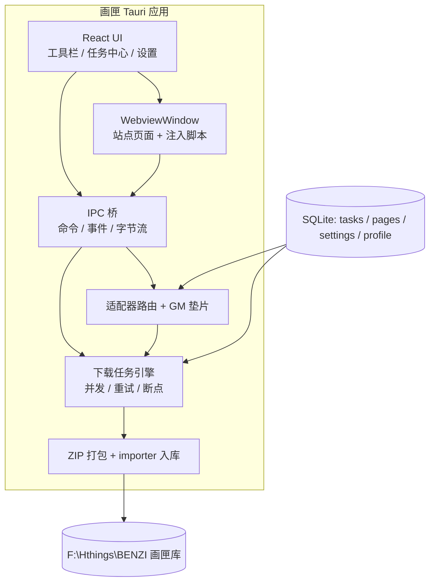

# D2 设计方案：画匣内建下载器（受控 WebView 路线）

- 建立时间：2026-11-19
- 状态：**管理员已确认；M1 最小闭环已实现，待用户 exhentai 登录态下端到端验收**（对应施工日志 D2）
- 参考素材：`D:\MESAVAGE\LINGSHI\下载内容\Comic Looms-4.16.1.txt`（油猴脚本，v4.16.1，约 1.5 万行，58 个站点适配器）
- 关联文档：[施工日志](施工日志.md) · [AGENT_API](AGENT_API.md) · [UI 清爽化方案](UI-PROPOSAL-2026-11-19.md)

---

## 1. 目标与边界

### 1.1 目标
在画匣内提供一个**受控浏览器窗口**，用户可在其中登录目标站点、浏览作品页；画匣通过注入脚本解析页面，生成带章节/页序/标签的任务，异步下载图片、打包 CBZ，并直接复用现有 importer 入库。

### 1.2 功能范围（尽量完整）
- 站点登录态管理（应用内 profile，不导入 Chrome Cookie）
- 作品元数据、章节、图片列表、分类标签解析
- 下载范围选择、章节合并、文件名排序规则、标题语言、镜像站、标签黑名单
- 并发控制、超时、重试、暂停/继续、失败重置、“获取已下载的”
- 逐图断点续传、原子落盘、流式 ZIP 打包
- 打包后自动入库（标题、标签、来源 URL 通过侧车文件传递）
- 任务中心、浏览工具栏、设置面板

### 1.3 非目标（本轮明确不做）
- 不做油猴市场 / 任意用户脚本支持
- 不做 Comic Looms 的 Greasyfork 自动更新（脚本版本固化在本地资源中）
- 不做 >1.2GB 自动分卷：画匣阅读器当前对分卷 CBZ 不友好，先单卷
- 不迁移 Comic Looms 全部 58 个适配器，只做首批 6 个站点

### 1.4 首批站点（管理员 2026-11-19 指定）
| 站点 | Comic Looms 现成适配器 | 首批策略 |
| --- | --- | --- |
| `https://exhentai.org/` | 有（e-hentai / EHMatcher） | 移植解析逻辑；保留镜像站配置；注意额度 |
| `https://nhentai.net/` | 有（NHMatcher） | 移植解析逻辑；无强制登录 |
| `https://18comic.vip/` | 有（禁漫 / Comic18Matcher） | 移植解析逻辑；域名变体多 |
| `https://pica.fanjugou18.top/` | 无 | 需实地勘察 DOM/API 后新写适配器 |
| `https://h-comic.com/` | 无 | 需实地勘察 DOM/API 后新写适配器 |
| `https://www.wnacg.com/` | 有（绅士漫画 / WnacgMatcher） | 移植解析逻辑；分页索引 12 页/页 |

---

## 2. 总体架构



原则：**页面 JS 只做解析，不做落盘；Rust 侧只做下载、存储与入库**。两者通过受控 IPC 通信。

---

## 3. 分层设计

### 3.1 WebView 层（Tauri v2）
- 使用 `WebviewWindow` 打开独立浏览窗口，独立用户数据目录（profile），与画匣主 UI、真实库物理隔离。
- 创建时注入初始化脚本（具体 API 以 Tauri v2 `WebviewWindowBuilder::initialization_script` 为准）。
- 提供地址栏、前进/后退/刷新、缩放、开发者工具开关（仅 debug 构建）。
- 导航白名单：仅允许首批 6 个站点及其图片 CDN 域名；其他域名弹窗询问或直接拦截。
- 所有站点内下载请求拦截后转 IPC，不由 WebView 直接写磁盘。

### 3.2 脚本运行时与 GM 垫片
注入脚本提供以下 API（对齐 Comic Looms 用法）：
- `GM_setValue / GM_getValue / GM_deleteValue / GM_listValues` → Rust 本地 SQLite
- `GM_xmlHttpRequest` → Rust HTTP 客户端，显式携带当前站点 Cookie，绕过页面 CORS
- `GM_addStyle` → 页面 `<style>` 注入
- `GM_notification` → Tauri 系统通知
- `GM_download` → IPC 字节流写入 staging 目录
- `@require` 依赖（zip.js 2.8.23 / FileSaver 2.0.5 / pica 9.0.1）打包为本地资源，不走 CDN
- `@match` / `workURLs` 由路由器负责匹配，决定加载哪个适配器

### 3.3 适配器接口

```ts
interface GalleryMeta {
  sourceUrl: string
  title: string
  titleAlt?: string
  cover?: string
  tags: Record<string, string[]>
  chapters: Chapter[]
}

interface Chapter {
  id: string
  title: string
  pages: PageRef[]
}

interface PageRef {
  index: number          // 阅读顺序
  thumbUrl?: string
  originUrl: string
  fileName?: string
}

interface SiteAdapter {
  id: string
  name: string
  matchHosts: string[]
  workUrlPatterns: RegExp[]
  parseGallery(doc: Document, url: string): Promise<GalleryMeta>
  resolveOrigin(page: PageRef): Promise<string>
}
```

适配器输出必须与 Comic Looms 的 `GalleryMeta` 语义一致，方便直接复用已验证的解析思路。

### 3.4 首批站点解析要点

- **exhentai.org**：Comic Looms 用 `EHMatcher`，作品详情页为入口；缩略图来自 sprite `background-image`，大图地址在页面脚本中；保留 `ehentaiMirrorHost` 镜像配置（注意镜像站可能不支持原图）；需尊重站点额度，默认低并发。
- **nhentai.net**：`NHMatcher`；图片 CDN 为 `i1..i4.nhentai.net`，缩略图为 `t1..t4`；扩展名映射 j/g/p/w → jpg/gif/png/webp；作品数据可从页面内嵌 JSON 读取。
- **18comic.vip**：`Comic18Matcher`；入口为 `/album/\d+`；脚本内有 `toMD5` 与 `get_num(gid, page)`，说明图片地址需要按站点算法生成；域名变体多（`jm18c-*` 等），适配器需同时匹配。
- **www.wnacg.com**：`WnacgMatcher`；入口 `photos-index-*` / `photos-slide-*`；每索引页 12 张，分页地址形如 `photos-index-page-{n}-aid-{id}.html`；大图列表藏在页面脚本中，需解析 JS；`preloadAllPages: true`。
- **pica.fanjugou18.top**：Comic Looms 无适配器，需实地打开作品页，确认是否有公开 API / 页面内嵌 JSON / 图片直链规则；预计需要一个新适配器文件。
- **h-comic.com**：同上，Comic Looms 无适配器，需实地勘察。

> 实际编码前必须对每个站点用真实页面验证一次；以上要点来自脚本静态分析，站点改版后以实地结果为准。

### 3.5 下载任务引擎（Rust）
- schema 从 v9 升到 **v10**，新增：
  - `download_tasks`：id、site、source_url、title、status、concurrency、staging_path、created_at、finished_at
  - `download_pages`：task_id、page_index、origin_url、status、retry_count、local_path、size
  - `download_settings`：并发、超时、文件名规则、标题语言、镜像站、标签黑名单等
- 页状态机：`pending → fetching → fetched / failed / excluded`
- 并发默认 5，超时 10s，失败指数退避；“获取已下载的”通过扫描 staging 文件 + 大小校验实现。
- 整任务支持暂停/继续；应用重启后按页状态恢复。
- ZIP 流式写入，避免大画集 OOM；命名规则支持 auto / numbers / original / alphabetically（对齐 Comic Looms 的自动检测逻辑）。

### 3.6 入库
- 打包完成后生成 `.gallerymeta.json` 侧车（标题、标签、来源 URL）。
- `galleryctl import` 增加 `--tags` 参数；桌面端调用 `import_on_connection` 并传入 `ImportOptions.tags`。
- 用现有哈希去重；只有确认入库成功后才能按用户配置删除 staging 或源文件（LINGSHI 铁律：库内有完整副本才删源）。

### 3.7 UI
- 浏览窗口：地址栏 + 站点徽标（已识别/未支持）+ 抓取本页按钮。
- 抓取面板：元数据、标签编辑、章节列表、页面网格（支持范围选择）、下载进度。
- 主界面：任务中心（暂停/继续/重试/删除）、下载设置页。
- 所有 UI 文案沿用现有风格，不引入新设计语言。

---

## 4. 安全与隐私
- 浏览 profile 与真实库隔离；页面 JS 只能调用白名单 IPC 命令，不能直接读写文件。
- Cookie/凭据仅本地存储，优先使用 Windows 凭据管理器 / DPAPI 加密。
- 库内容（路径、标签、封面、文件名）不得外发，继续遵守施工守则“库只进不出”。
- IPC 命令做参数校验，禁止任意路径、任意 URL。

---

## 5. 里程碑（先框架后站点）

1. **M1 最小闭环**：打开 exhentai 作品页 → 解析 → 下载 1 页 → 打包 → 入库成功。
2. **M2 运行时补齐**：GM 垫片、本地 zip.js/pica、导航白名单、站点登录态持久化。
3. **M3 任务引擎**：并发/重试/暂停/断点/范围选择/失败重置。
4. **M4 入库打通**：侧车元数据、`galleryctl --tags`、哈希去重、删除源确认。
5. **M5 UI 与设置**：任务中心、工具栏、设置面板。
6. **M6 站点扩充**：nhentai → 18comic → wnacg → pica → h-comic，每站真实页面验收。

每个里程碑产出后更新施工日志与 WORKLOG；动代码前确保 `git status` 干净、基线测试通过；完成后 `npm run check` + `cargo test --lib` 全绿。

---

## 6. 风险与对策

| 风险 | 对策 |
| --- | --- |
| 站点改版导致适配器失效 | 适配器独立文件、单站可替换；每站保留最小测试用例 |
| exhentai 额度/封禁 | 默认并发 ≤5、镜像站可选、失败退避 |
| WebView Cookie 与主浏览器不互通 | 在应用内登录一次；不做 Chrome Cookie 导入 |
| GM 垫片行为不一致 | 垫片层单测；优先只用 Comic Looms 实际调用的 API 子集 |
| 大画集内存占用 | ZIP 流式写入；不做整包内存缓冲 |
| 分卷包阅读不兼容 | 本轮不做分卷；如后续需要单独评估阅读器支持 |
| 隐私泄露 | profile 隔离、IPC 白名单、库内容不外发 |

---

## 7. 待管理员确认
1. 是否保持“不做自动脚本更新、不做分卷”两项非目标？
2. pica.fanjugou18.top 与 h-comic.com 是否允许我实际打开页面做结构勘察（仅看 DOM/网络结构，不下载内容）？
3. 入库成功后是否默认删除 staging 下载缓存？（默认保留，手动清理）

---

## 8. 实施进展

- **2026-11-19 · M1**：管理员确认上述默认项后开工。已实现 `d2_fetch_first` 命令与最小 UI 入口：打开 exhentai/e-hentai 作品页 → 页面内解析 `#gd2 h1`、`#taglist`、第一张缩略图链接 → 在图片页取原图 → 字节回传 Rust → 写单页 CBZ → 复用 `importer` 入库并挂标签。
- 当前实现刻意只抓第一页、不做 schema v10、不做任务中心；这些属于 M3/M5。端到端验收需要用户在弹出窗口内完成 exhentai 登录。
- 验证状态：`npm run check`、`npm run build`、`cargo check`、`cargo test --lib`（45 项，含 2 项 D2 辅助函数测试）均通过；真实站点 E2E 待登录验收。
